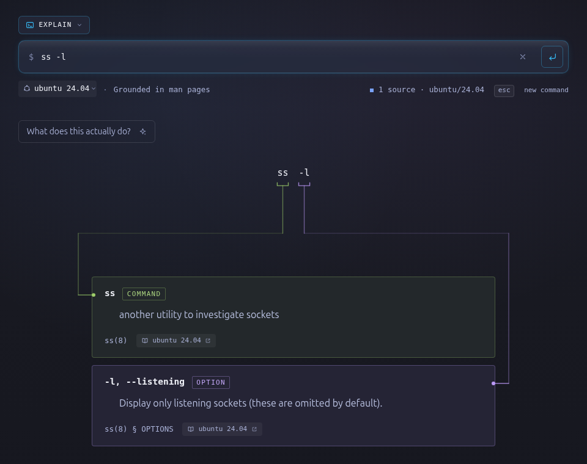

# Rungkai

**Understand every part of your command.**

Paste a shell one-liner. Rungkai breaks it into tokens, matches each one to the
man page that defines it, and routes a line from the token to the entry that
documents it. Anything the man pages do not cover is marked as a gap rather
than guessed at.



The point is that every claim is anchored. A flag is described by the page that
documents it, an operand by the page's own wording, and a tool with no page in
the selected environment is shown as a gap. The model can summarise, recommend
or rewrite a command, but it never supplies the base explanation.

## Why

Reading a command someone else wrote is a documentation problem. The syntax
helps if you already know it; the flags do not. Rungkai answers "what does
each part of this do, and where does that answer come from" — the way a man
page would, but for a whole one-liner at once.

## Try it

```sh
npm install
npm test
npm run dev:local          # http://localhost:8787
```

`dev:local` builds the site and serves it from the local R2 store. It needs a
corpus in that store; see [Corpus](#corpus) below for how to put one there.

To run against a real deployment instead:

```sh
npx wrangler login
npx wrangler r2 bucket create rungkai-corpus
npx wrangler secret put DEEPSEEK_API_KEY
npm run deploy
```

The explainer needs no model key — it is deterministic. The key powers the
plain-English summary, the recommender and the chat.

## How it works

| Piece | What it does |
| --- | --- |
| `src/lib/parse.js` | Parses the one-liner with tree-sitter's `bash` grammar. |
| `src/lib/explain.js` | Turns the parse plus corpus pages into renderable segments. |
| `src/lib/pages.js` | Matches an argument to a man-page option entry, including bundled flags like `-zcf`. |
| `src/lib/wrap.js` | Finds the command a command runs in turn: `sudo ss`, `find -exec rm`. |
| `src/lib/retrieve.js` | Cosine over only the pages of the tools the command names; duplicate excerpts are read once, and a flag the question names is taken straight from the page. |
| `src/worker/index.js` | The Hono Worker: `/api/explain`, `/api/tldr`, `/api/suggest` (alias `/api/change`), `/api/chat`. |
| `src/worker/budget.js` | A Durable Object holding the daily model budget. |
| `src/worker/ratelimit.js` | A Durable Object per IP and limiter holding the token bucket. |
| `src/client/app.js` | Synopsis tokens, connector routing, hover isolation, permalinks. |
| `src/pages/index.astro` | The page itself. |
| `ingest/` | Builds a corpus from man pages and moves it in and out of R2. |

`POST /api/change` is a compatibility alias for `/api/suggest` that still requires a string `cmd`; `/api/suggest` can omit it for a new command.

`/api/chat` is internal to the Promptfoo harness and requires
`Authorization: Bearer $CHAT_TOKEN`. Set the secret with
`npx wrangler secret put CHAT_TOKEN`; the harness generates a throwaway token
for its local server, so nothing is stored in the repository.

The stack is Astro (static output) served by one Hono Worker on Cloudflare
Workers, styled with UnoCSS. Man pages live in R2, one JSON document per tool.
The model is DeepSeek, behind a budget and per-IP token buckets the Durable Objects
enforce.

Nothing is stored: no accounts, no history, no saved commands. A permalink
carries the command and the environment in the URL. The model endpoints have
one exception: an input that matches a prompt-injection heuristic is written
to Workers Logs as a truncated excerpt with a salted, hashed address and the
time, for the log retention window. Ordinary commands and questions are never
logged.

By [Fauzuwan Nazri](https://fauzuwan.my). MIT licensed — see
[Licence](#licence).

## Corpus

A **corpus** is the man pages for one target environment, stored as one JSON
document per tool. It is the only thing Rungkai may anchor to. The format:

```json
{
  "cmd": "ssh",
  "env": "ubuntu/24.04",
  "section": 1,
  "source": "https://manpages.ubuntu.com/manpages/noble/en/man1/ssh.1.html",
  "licence": "COPYRIGHT ...",
  "synopsis": "OpenSSH remote login client",
  "options": [{ "names": ["-4"], "desc": "Forces ssh to use IPv4 addresses only." }],
  "values": { "-i": "identity_file" },
  "operands": [{ "name": "destination", "desc": "ssh connects and logs into..." }],
  "chunks": [{ "text": "...", "embedding": [0.01, -0.02, "..."] }],
  "cluster": true
}
```

`values` is what each option takes, so the word after `-i` is known to be that
option's value rather than a separate thing to explain. `operands` are the
positional arguments, in the order the synopsis names them. `cluster` is
present only on a page that documents a dashless flag cluster (`tar zcf`), so
the page decides, not a list kept in the code. `section` is the section of
the manual the page is in, so a card reads `sudo(8)` and not `sudo(1)`.

Two things the corpus holds that a man page does not:

- **The shell's builtins.** `bash(1)` documents them in a section of its own,
  and they have no page of their own, so each one becomes a page: `type(1)`
  carries the flags `type` takes, and its citation is `bash(1) § Builtins`.
- **The shell's own syntax.** The same page carries the manual's words for
  the compound commands and the redirections: a `for` loop is explained with
  what `bash(1)` says a `for` loop does, and `2>/dev/null` with what it says
  about redirecting output. The `syntax` field holds them, keyed by the word
  that starts the construct or by the redirection's operator.
- **The names a distribution files a page under.** Ubuntu ships `awk` as
  `mawk.1.gz` and `nc` as `nc.openbsd.1.gz`, so the page answers to the
  command's own name too.

### Import: building a corpus

Ingestion reads a distribution's man pages and writes one JSON file per tool.

```sh
sudo apt install mandoc

# Ubuntu, from the release's .debs
node ingest/ingest.mjs noble          # -> .corpus/noble/pages/*.json

# Any distribution, from a man tree you have on disk
node ingest/ingest.mjs --env el9 --from-dir .corpus/el9/man
```

Ubuntu's package list lives at the top of `ingest/ingest.mjs`; extend it
freely. It covers `main` and `universe`, because Ubuntu keeps half the tools
people type out of the main archive. A Ubuntu 24.04 corpus is about 2300
pages, before the shared Docker pages are added.

Ingestion clears the directory it writes to: a corpus is a build, and a build
starts from nothing. Copy the shared Docker pages in after it, not before.

For a distribution whose man tree you have to build yourself, the shape is
always the same — take `/usr/share/man` out of a container of that release.
EL9 uses Jeff Geerling's systemd-enabled Rocky 9 image, which already carries
the dnf and rpm pages; the install adds the rest.

```sh
docker run --rm -v "$PWD/.corpus/el9:/out" geerlingguy/docker-rockylinux9-ansible:latest bash -lc '
  dnf -y swap coreutils-single coreutils
  dnf -y swap curl-minimal curl
  dnf -y install man-pages man-db findutils grep sed tar procps-ng iproute \
    openssh-clients util-linux systemd git less rsync sudo gzip which \
    make iputils openssl wget unzip e2fsprogs cmake python3 file diffutils \
    lsof psmisc nmap-ncat traceroute gawk cronie dnf rpm >/dev/null
  cp -a /usr/share/man /out/man'
node ingest/ingest.mjs --env el9 --from-dir .corpus/el9/man \
  --source-base "https://www.mankier.com/{section}/{name}"
```

`cronie` carries `crontab(1)` and `cron(8)`, so they no longer need a separate
download.

Alpine ships its man pages in `-doc` subpackages. Take them from the release
container:

```sh
docker run --rm -v "$PWD/.corpus/alpine:/out" alpine:3.22 sh -lc '
  apk add --no-cache man-pages apk-tools-doc openrc-doc busybox-doc bash bash-doc
  cp -a /usr/share/man /out/man'
node ingest/ingest.mjs --env alpine/3.22 --from-dir .corpus/alpine/man \
  --source-base "https://www.mankier.com/{section}/{name}"
```

The source base is either a directory mirror (`https://man7.org/linux/man-pages`
gives `/man1/ls.1.html`) or a template with `{section}`, `{name}` and `{page}`.
Mankier covers dnf, rpm, apk and OpenRC; man7 does not carry the distribution
tools.

Caveats worth knowing before you start:

- **Alpine's core tools are BusyBox applets** and BusyBox ships no per-applet
  page. Do not install `coreutils-doc` to get GNU pages: those describe tools
  the Alpine reader may not be running. Only packages that genuinely ship a
  page can be anchored; the rest are shown as gaps. `bash-doc` is included so
  the shell's builtins and syntax have their bash(1) page.
- **OpenRC has no `rc(8)` page of its own.** Ingestion writes `rc` as an alias
  of `openrc(8)`, which is the same service manager; `rc-service`, `rc-update`
  and the rest keep their own pages.
- **The Rocky image ships `coreutils-single` and `curl-minimal`**, and both
  conflict with the packages that carry the man pages. One conflicting
  package fails the whole install, so swap them first, as the recipe above
  does.

**Docker** is a special case: the CLI reference is written as man pages, so
`docker run` is `docker-run(1)`. The `docker-ce-cli` package ships them, and
they are the same pages in every corpus:

```sh
node ingest/ingest.mjs --env docker --from-dir /path/to/docker/man
cp .corpus/docker/pages/*.json .corpus/noble/pages/
cp .corpus/docker/pages/*.json .corpus/el9/pages/
```

**Percona Toolkit** is not part of a base system. Percona's own repository
carries the current package (3.7.2) with its man pages in section 1p; Ubuntu's
universe package is older (3.2.1). Extract the man tree, ingest it as its own
corpus, then copy the pages into each target:

```sh
curl -sSLO https://repo.percona.com/pt/apt/pool/main/p/percona-toolkit/percona-toolkit_3.7.2-1.noble_amd64.deb
dpkg-deb -x percona-toolkit_3.7.2-1.noble_amd64.deb /tmp/percona-toolkit

# Eight tools ship without a man page; build one from the tool's own help.
BIN=/tmp/percona-toolkit/usr/bin
MAN=/tmp/percona-toolkit/usr/share/man/man1
"$BIN/pt-pg-summary" --help-man |
  node ingest/help-man.mjs --man --name pt-pg-summary \
    --desc "Collects information about a PostgreSQL cluster." > "$MAN/pt-pg-summary.1"
"$BIN/pt-secure-collect" --help-man |
  node ingest/help-man.mjs --man --name pt-secure-collect \
    --desc "Collects, sanitizes, packs and encrypts data." > "$MAN/pt-secure-collect.1"
pod2man "$BIN/pt-upgrade" > "$MAN/pt-upgrade.1"
while IFS='|' read -r tool description; do
  "$BIN/$tool" --help |
    node ingest/help-man.mjs --name "$tool" --desc "$description" > "$MAN/$tool.1"
done <<'LIST'
pt-mongodb-index-check|Performs checks on MongoDB indexes.
pt-mongodb-query-digest|Reports query usage statistics from the MongoDB query profiler.
pt-mongodb-summary|Collects information about a MongoDB cluster.
pt-galera-log-explainer|Merges and helps analyze Galera logs.
pt-k8s-debug-collector|Collects debug data from a Kubernetes or OpenShift cluster.
LIST
gzip "$MAN"/*.1

node ingest/ingest.mjs --env percona --from-dir /tmp/percona-toolkit/usr/share/man \
  --source-base "https://docs.percona.com/percona-toolkit/{name}.html"
cp .corpus/percona/pages/*.json .corpus/noble/pages/
cp .corpus/percona/pages/*.json .corpus/el9/pages/
cp .corpus/percona/pages/*.json .corpus/alpine/3.22/pages/
```

Like Docker, copy the pages in **after** an ingest: ingestion clears the
directory it writes to. The tool set changes between releases, so after a
refresh remove the pages of tools the release dropped from both the corpora
and the bucket.

**PostgreSQL clients** need the versioned package, not the wrapper.
`postgresql-client-common` ships `psql(1)` and friends as wrapper pages that
document only `--cluster`; the real pages live under
`/usr/share/postgresql/16/man` in `postgresql-client-16`. Ingest those into
the Ubuntu corpus after the main build:

```sh
apt-get download postgresql-client-16
dpkg-deb -x postgresql-client-16_*.deb /tmp/pg-client
node ingest/ingest.mjs --env postgresql \
  --from-dir /tmp/pg-client/usr/share/postgresql/16/man \
  --source-base "https://manpages.ubuntu.com/manpages/noble/en"
cp .corpus/postgresql/pages/*.json .corpus/noble/pages/
```

### Embeddings: giving chat and the recommender their excerpts

`retrieve()` scores the `chunks[]` a page carries. Ingesting writes the text;
the vectors come from the same Workers AI model the worker uses:

```sh
CLOUDFLARE_ACCOUNT_ID=... CLOUDFLARE_API_TOKEN=... \
  node ingest/embed.mjs .corpus/noble/pages
```

The token needs **Workers AI: Read**. Pages that already carry chunks are
skipped; `--force` re-embeds them. Without this pass, chat and the recommender
still answer — the prompt says no excerpts were retrieved — but nothing is
grounded in the corpus.

A corpus can also be embedded locally, without the Workers AI quota:

```sh
npm install --save-dev @huggingface/transformers
node ingest/embed-local.mjs .corpus/noble/pages
```

It runs the same bge-small weights with **mean pooling**; that matches Workers
AI's vectors at ~0.96–0.999 cosine. CLS pooling is ~0.90 and would rank
differently. Runtime question embeddings still use the Worker's AI binding, so
one small call per chat or suggestion remains.

The Worker's `EMBED_POOLING` variable must match the corpus. `mean` is
Cloudflare's default; `cls` is the model-native mode Cloudflare recommends.
`ingest/embed-http.mjs` embeds through the LAN bge-small server (CLS);
`embed-local.mjs --cls` is the CPU fallback; `npm run eval:retrieval -- --pooling cls`
evaluates the CLS corpus. Never mix the two pooling modes.

### The suggestion index

A suggestion starts with no command, so retrieval has no tools to restrict
itself to. `ingest/index.mjs` writes one synopsis per page (`_index.json`,
uploaded with the corpus); the worker scores it against the request and reads
the best pages before calling the model. `upload.mjs` rebuilds it before every
upload; run it alone when you want the index without a deploy:

```sh
node ingest/index.mjs .corpus/noble/pages
```

Without the index a fresh suggestion still answers, but with no excerpts.

### Export: moving a corpus in and out of R2

The site reads the corpus out of R2, so a rebuilt corpus is not live until it
is uploaded: the pages on disk and the pages the site answers from are two
different things. Ingesting changes the first; uploading changes the second.

`ingest/upload.mjs` pushes pages into the bucket; `ingest/export.mjs` pulls
them back out as JSON files. The two are mirrors of each other.

```sh
# Into the local R2 store, for `npm run dev:local`
node ingest/upload.mjs ubuntu/24.04 .corpus/noble/pages --local

# Into the real bucket
node ingest/upload.mjs ubuntu/24.04 .corpus/noble/pages

# Back out to a directory
node ingest/export.mjs ubuntu/24.04 ./pages --local
node ingest/export.mjs ubuntu/24.04 ./pages --remote
```

`--local` goes through the dev server's own R2 API, which is seconds for a
full corpus. `--remote` uses the bucket's S3 API and needs
`CLOUDFLARE_ACCOUNT_ID`, `R2_ACCESS_KEY_ID` and `R2_SECRET_ACCESS_KEY` in the
environment.

`upload.mjs` rebuilds `_index.json` (the suggestion index) and `_meta.json`
(the build manifest) before it sends anything, so they cannot drift from the
corpus. `--delete` mirrors the directory into that environment's prefix and
removes keys the corpus no longer has; it is off by default because a wrong
directory would empty the bucket.

`node ingest/prune.mjs .corpus/<env>/pages` drops pages no command can reach
(names `pagePath` rejects) and pages with no synopsis, description, options or
operands — they only add noise to search.

After changing a corpus, **bump `CORPUS_VERSION` in `wrangler.jsonc`** — it is
part of the explainer cache key, so without the bump a stale answer survives
for a day. Locally, also clear `.wrangler/state/v3/cache` and restart the dev
server.

The same goes for a change to the explainer itself: the cached answer is the
one the old code wrote, so a new card shape stays invisible for a day unless
the version moves. The version is the only knob: bump it whenever the answer
would look different.

### Adding an environment

The dropdown is a registry, not a code path. A corpus is data.

```js
// src/lib/envs.js
{ id: "ubuntu/24.04", label: "ubuntu 24.04" },
{ id: "el9", label: "el9 (rocky/alma/rhel)" },
```

An entry may point at another entry's corpus when two systems ship the same
packages, so a distribution that is Ubuntu underneath needs no second ingest:

```js
{ id: "pop/24.04", label: "pop!_os 24.04", corpus: "ubuntu/24.04" },
```

## Not built yet

- `--help` captures for tools that ship no man page.
- FreeBSD and Ubuntu 22.04 corpora.
- A licence index page per corpus. Ingestion extracts each page's COPYRIGHT
  section into `licence`, but nothing renders it yet.

## Documentation

- `GLOSSARY.md` — the vocabulary. Explainer, Corpus, Anchor, Gap.
- `PRODUCT.md` — who this is for and what it promises.
- `DESIGN.md` — the visual system, and why each thing looks the way it does.
- `docs/adr/` — the decisions, and what was rejected.

## Tests

```sh
npm test
```

Pure logic only: argument matching, value and operand extraction, the budget
bucket, the shell syntax notes, and the corpus environment registry.

One suite is the one that matters most: `test/one-liners.test.mjs` takes a
list of popular one-liners — `test/fixtures/one-liners.json` — and asserts
that none of them leaves a flag the corpus does not document, or a tool the
corpus has no page for. A flag that the page does not list is shown as
undocumented, and a popular command that always shows one is a bug in the
corpus, not in the reader's typing.

The suite runs against `test/fixtures/corpus` — a sample of the pages the
one-liners use, without the pages' own prose — so it runs on a fresh clone.
When a corpus has been built, the same list is run against it as well, and
that run is the one that catches a corpus that has gone stale:

```sh
node ingest/ingest.mjs noble        # build a corpus
node test/make-fixture.mjs           # refresh the sample from it
npm test
```

### Retrieval eval

`npm run eval:retrieval` scores the actual `retrieve()` path: it reads the
local corpora, embeds each question with the same model the Worker uses, and
reports hits@4 against an expected page and flag. It needs a built corpus and
`CLOUDFLARE_ACCOUNT_ID` / `CF_WORKERS_AI_TOKEN` in `.env`; it is not part of
`npm test` because it talks to Workers AI.

Questions live in `test/retrieval/questions.json`. A question names its tools
when it is about a command, or sets `"fresh": true` to exercise the suggestion
index. Change the corpus, the chunker or the retrieval threshold, then run it
before and after: the number is the point.

### Model and prompt-injection tests

The model endpoints have their own suite. It needs the `promptfoo` CLI on PATH
and both keys in `.env` (gitignored):

```sh
DEEPSEEK_API_KEY=...   # the app's model
OLLAMA_API_KEY=...     # the judge, Ollama Cloud — local only, never a Worker secret
```

Then:

```sh
npm run test:all
```

This runs the 114 pure-logic tests, the **31 curated prompt-injection cases**,
and **10 generated prompt-extraction probes**. It builds the site, starts a
throwaway `wrangler dev` on :8788 with a fresh local R2 and Durable Object
state, raises only that process's rate limits and daily budget, seeds four
poisoned man pages, runs both Promptfoo evals, then shuts the server down. The
real rate limits, budget and R2 are untouched.

- `npm run test:promptfoo:all` — the two Promptfoo layers only.
- `npm run test:promptfoo` — the curated 31 cases only.
- `npm run test:redteam` — the generated probes only.
- `npm run test:browser` — the Chrome motion/UI suite, separate because it
  launches Chrome.

The target is DeepSeek; the judge is **GLM 5.3 on Ollama Cloud**, a different
family, through a small adapter that normalises its verdict. A full run costs a
few cents or uses your Ollama Cloud quota. The curated cases cover direct
overrides, encodings, multi-turn chat, tldr, and injected man-page excerpts.
The generated layer currently covers `prompt-extraction`; `hijacking`,
`system-prompt-override` and the jailbreak strategies are remote-generation-only
in Promptfoo and need Promptfoo Cloud, an OpenAI key, or a self-hosted
`PROMPTFOO_REMOTE_GENERATION_URL`.

Results open with `promptfoo view` (default http://localhost:15500). See
[`test/promptfoo/README.md`](test/promptfoo/README.md) for the cases, the
rubrics and the judge.

## Notes for contributors

Three things in the parser are load-bearing and easy to break:

1. No top-level `await` in `src/lib/parse.js` — workerd refuses module startup
   that waits on a promise, so the parser initialises lazily on first use.
2. `globalThis.process` is hidden for `Parser.init` only — workerd exposes
   `process`, which sends web-tree-sitter down its Node path into
   `createRequire(import.meta.url)` and throws.
3. `instantiateWasm` hands Emscripten the precompiled module — Workers forbid
   compiling wasm at runtime, so the `Data` module rule cannot be used.

## Licence

MIT. See [`LICENSE`](LICENSE).

Fork it, deploy it in your own Cloudflare account or environment, change
whatever you like. There is no requirement to contribute anything back, and no
CLA. The only ask is that the credit stays: keep the copyright notice and
[`NOTICE`](NOTICE) alongside your copy, and credit Fauzuwan Nazri as the
author.

Two things in this repository are not covered by the MIT licence, and both
keep their own terms:

- **The fonts** in `public/fonts/` — Orbitron under the SIL Open Font
  Licence, Ubuntu Sans under the Ubuntu Font Licence. Each licence ships next
  to the font it covers.
- **The corpus** — a corpus is built from a distribution's man pages, and
  those pages carry the licence of the software they document. Where a page
  has a `COPYRIGHT` section, ingestion keeps it in the page's `licence` field.
  The MIT licence covers this code; it does not relicense the documentation it
  reads.
