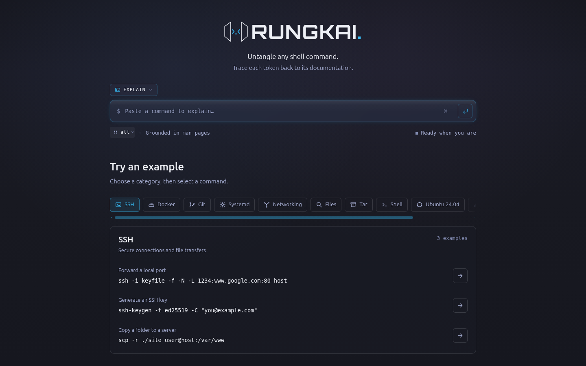
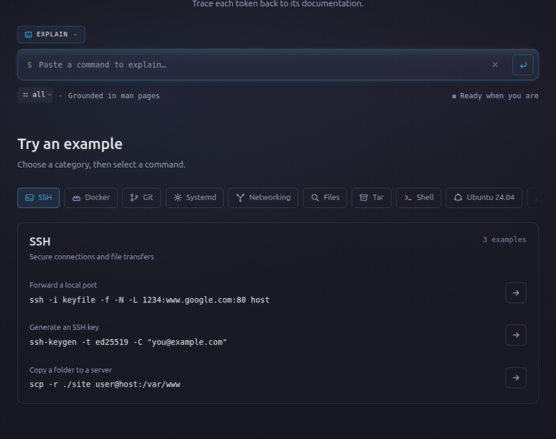
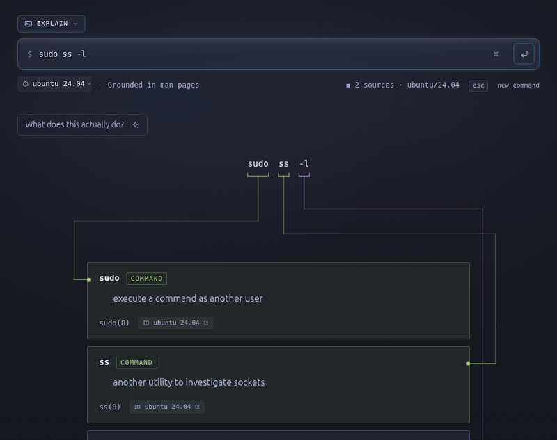
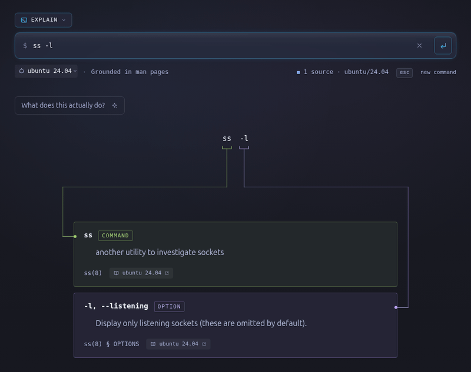
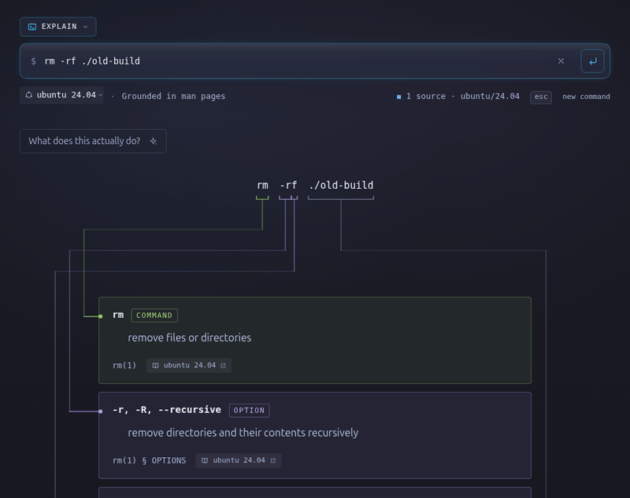
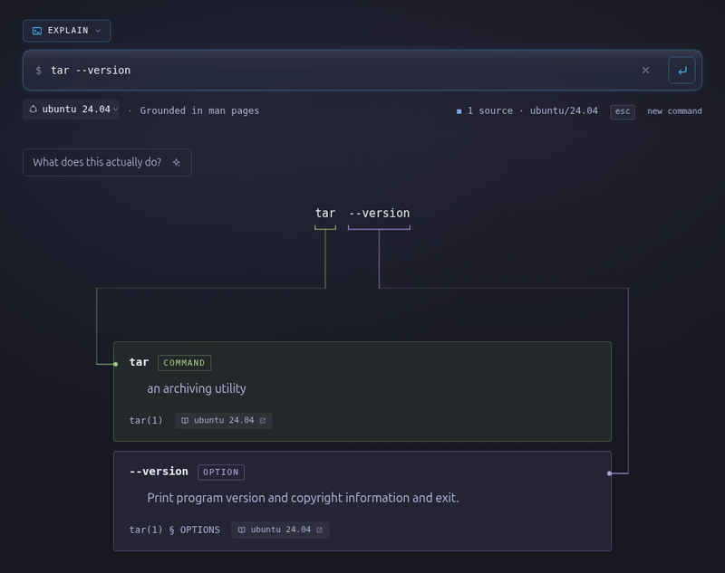

# Rungkai

**Understand every part of your command.**

Rungkai breaks a shell one-liner into tokens and connects each documented tool,
flag, operand and shell construct to its source. Missing documentation appears
as a gap. The base explanation is deterministic; optional AI features summarise
the command or suggest one from a plain-language request.

<p align="center">
  <a href="https://git.zyzyx.cc/zyzyx/rungkai/raw/branch/main/docs/images/home.png"></a>
</p>

## Feature demos

Each tile is a looping capture of the running app. Click a demo for a closer look.

<table>
  <tr>
    <td align="center" width="50%">
      <a href="https://git.zyzyx.cc/zyzyx/rungkai/raw/branch/main/docs/images/explainer-demo.gif"></a><br />
      <strong>Explain</strong> · trace tokens to their sources
    </td>
    <td align="center" width="50%">
      <a href="https://git.zyzyx.cc/zyzyx/rungkai/raw/branch/main/docs/images/feature-bahasa-melayu.gif"></a><br />
      <strong>Bahasa Melayu</strong> · ask for a command in your own words
    </td>
  </tr>
  <tr>
    <td align="center">
      <a href="https://git.zyzyx.cc/zyzyx/rungkai/raw/branch/main/docs/images/feature-nested.gif"></a><br />
      <strong>Nested commands</strong> · follow what a wrapper runs
    </td>
    <td align="center">
      <a href="https://git.zyzyx.cc/zyzyx/rungkai/raw/branch/main/docs/images/feature-environments.gif"></a><br />
      <strong>Environments</strong> · read the matching documentation
    </td>
  </tr>
  <tr>
    <td align="center">
      <a href="https://git.zyzyx.cc/zyzyx/rungkai/raw/branch/main/docs/images/feature-summary.gif"></a><br />
      <strong>Plain-English summary</strong> · see what the command changes
    </td>
    <td align="center">
      <a href="https://git.zyzyx.cc/zyzyx/rungkai/raw/branch/main/docs/images/feature-gaps.gif"></a><br />
      <strong>Visible gaps</strong> · know where documentation ends
    </td>
  </tr>
</table>

Bahasa Melayu requests work in Suggest mode; the interface, manual excerpts
and the captured model response are in English. Suggestions and summaries need
the optional model configuration.

## What works today

- **Explain a command:** pipelines, redirections, substitutions, quoting,
  compound commands, bundled flags, option values and positional arguments.
- **Follow nested commands:** wrappers such as `sudo` and commands run through
  constructs such as `find -exec` are resolved to their own documentation.
- **Choose an environment:** Ubuntu 24.04, EL9 (Rocky/Alma/RHEL), Alpine 3.22,
  or `all`. The default `all` searches the registered corpora and labels each
  source; it does not guarantee that every tool exists on one machine.
- **Read the sources:** interactive token-to-entry connectors, manual links,
  visible documentation gaps and grouped examples.
- **Use AI when configured:** a streamed plain-English summary with risk
  indicators, fresh command suggestions, and changes to an existing command.
  Suggestions include a rationale, assumptions, and a check of which tools have
  corpus pages. That check does not validate every flag or prove a command safe.
- **Ask in Bahasa Melayu:** describe the task in Suggest mode, for example
  `Senaraikan fail yang lebih besar daripada 100MB dalam folder semasa`.
- **Share a view:** permalinks carry the command and environment; browser Back
  and Forward restore previous views. Ctrl/Cmd+K focuses the command input.

Rungkai reads commands; it does not execute them. Input is limited to a single
line of up to 1,024 JavaScript string characters. Control and invisible format
characters are rejected. Parsing uses Bash grammar, including when the selected
corpus is Alpine; this is not an interpreter for every shell dialect.

## Run locally

Use **Node.js 22.23.4 or newer** and npm. The repository includes a lockfile,
test fixtures and a small demo page, but no complete production corpus.

```sh
npm ci
npm test
npm run dev:local
```

Open <http://localhost:8787>. This builds the Astro site and serves it through
Wrangler with local R2 and Durable Objects. Re-run the command after editing the
frontend to rebuild the static assets.

An empty R2 store produces documentation gaps. For a small demo, run this in a
second terminal, then explain `tar -zcf archive.tar.gz ./src` with Ubuntu 24.04
selected:

```sh
npx wrangler r2 object put rungkai-corpus/ubuntu/24.04/tar.json \
  --file seed/tar.json --local
```

`seed/tar.json` is a deliberately incomplete fixture, not a fully ingested man
page. For normal use, [build and upload a corpus](#build-a-corpus). If an empty
answer was already cached, clear `.wrangler/state/v3/cache` and restart the dev
server after loading pages.

The explainer needs no model key. To enable local summaries and suggestions,
create a gitignored `.dev.vars` file:

```dotenv
DEEPSEEK_API_KEY=your-key
```

The local configuration has no Workers AI binding. Retrieval falls back to word
overlap over available text chunks, plus exact option matches. Production uses
Workers AI embeddings. `.env` is used by evaluation scripts; `.dev.vars` supplies
local Worker secrets.

## Deploy to Cloudflare

The app runs as one Worker with static assets, an R2 corpus bucket, a Workers AI
binding and two SQLite Durable Object classes. Review
[`wrangler.jsonc`](wrangler.jsonc) for your account before deploying.

Use your own Cloudflare login and select your account if you belong to several.
You can keep the Worker name `rungkai` and bucket name `rungkai-corpus` in your
account. To rename them, change `name` and `r2_buckets[].bucket_name` in Wrangler;
keep the binding names (`CORPUS`, `AI`, `BUDGET`, `RATE_LIMIT`) as they are. The
bucket name is also hardcoded as `BUCKET` in `ingest/upload.mjs` and
`ingest/export.mjs`: update both if you choose a different bucket. Update
`wrangler.local.jsonc` too if you want local development to use that name.

```sh
npx wrangler login
npx wrangler r2 bucket create rungkai-corpus

# Deploy the site, Worker, bindings and Durable Object migrations.
npm run deploy

# Optional: enable model features on the deployed Worker.
npx wrangler secret put DEEPSEEK_API_KEY
```

Upload your built corpus separately: deploying the Worker does not publish
`.corpus/`. Build it on a Linux machine or Linux container with the ingestion
tools and source documentation; a GPU is optional. After choosing an embedding
path below, follow [Prepare and upload](#prepare-and-upload), bump
`CORPUS_VERSION`, and deploy again.

`npm run dev` uses Wrangler's **remote** mode and real Cloudflare
resources; `npm run dev:local` uses the local configuration.

### Choose where embeddings run

Document embeddings are generated when building or refreshing the corpus.
Query embeddings are generated during semantic retrieval for suggestions and
chat. The deterministic explainer and the summary endpoint do not need
embeddings. With the current code, query embeddings run on **Workers AI** when
the `AI` binding is present; an ingestion GPU does not serve live queries.

| Setup | Document embeddings | Live retrieval | Required changes |
| --- | --- | --- | --- |
| No GPU; use Workers AI quota for all embeddings | `ingest/embed.mjs` on Workers AI | Workers AI BGE | Set Worker model to BGE and pooling to `mean` |
| Own GPU; keep Workers AI queries | `ingest/embed-http.mjs` against your service | Workers AI with the matching model | Configure your HTTP service and match the Worker model |
| No GPU; save ingestion Neurons | `ingest/embed-local.mjs` on CPU | Workers AI BGE | Set Worker model to BGE and match pooling |
| No Workers AI; lexical retrieval | CPU BGE or existing text chunks | Word overlap and exact flag matches | Remove the `ai` binding from the deployed Wrangler config |
| Own service for both documents and queries | Your HTTP embedding service | Your service | Change `src/lib/retrieve.js`; no runtime HTTP-provider setting exists yet |

**No GPU, all embeddings on Workers AI.** The existing REST ingestion script
uses BGE, so set these variables in `wrangler.jsonc` (and the local config if you
want them aligned):

```json
"EMBED_MODEL": "@cf/baai/bge-small-en-v1.5",
"EMBED_POOLING": "mean"
```

Then embed the built corpus with credentials from your own Cloudflare account:

```sh
CLOUDFLARE_ACCOUNT_ID=your-account-id \
CLOUDFLARE_API_TOKEN=your-workers-ai-token \
  node ingest/embed.mjs .corpus/noble/pages --force
```

The token needs Workers AI access. `--force` replaces existing vectors when
switching models; omit it on subsequent runs to resume completed pages. Upload
with `EMBED_MODEL='@cf/baai/bge-small-en-v1.5'` to label the manifest correctly.
Using Qwen3 for this path instead requires updating `ingest/embed.mjs` to use
Qwen3's model and document-input contract; changing an environment variable
alone does not change that script's hardcoded BGE model.

Cloudflare currently includes 10,000 Neurons per day, resetting at 00:00 UTC.
Corpus embedding and live query embedding share your account's allowance; a
large corpus may need several days. Completed pages can be reused rather than
embedded again. Check usage in the dashboard and consult
[Workers AI pricing](https://developers.cloudflare.com/workers-ai/platform/pricing/)
for current quotas and paid usage. Page count alone does not determine cost:
the model and the amount of text embedded matter.

**Own GPU.** Run a compatible embedding service on your machine and point
`EMBED_URL` at it using the [HTTP ingestion instructions](#embed-documentation-for-retrieval).
For the default Qwen3 deployment, serve the corresponding Qwen3 weights. The
GPU only needs to be available while building or refreshing documents; upload
the resulting JSON to R2, and live queries continue through Workers AI. This
avoids document-embedding Neuron usage, while query embeddings still use quota.

**CPU ingestion.** No GPU or embedding service is needed for the local BGE
script, though the first run downloads model weights and ingestion can be slow:

```sh
node ingest/embed-local.mjs .corpus/noble/pages --force
```

Set the Worker to BGE with `mean` pooling as above. If using `--cls`, set
`EMBED_POOLING` to `cls` too. This saves ingestion Neurons; live semantic queries
still use Workers AI.

**No Workers AI at all.** Removing the `ai` binding selects the existing word
overlap fallback, which works from text chunks without query vectors. CPU
ingestion can populate those chunks. To retain semantic retrieval through your
own GPU or CPU service, implement an authenticated HTTP query-embedding call in
`src/lib/retrieve.js` in place of `env.AI.run`, and adjust the no-`AI` fallback
branch. The endpoint must be reachable from the deployed Worker and use the
same embedding contract as the corpus. Setting `EMBED_URL` currently affects
ingestion only.

For every semantic path, match model weights, dimensions, pooling and the
model's document/query instruction conventions. Different vector widths are
discarded; incompatible vectors of the same width can silently rank badly.

“All Neurons” here means **all embeddings**. Summaries, suggestions and chat
still call DeepSeek directly and use its separate API key and billing. Moving
generation to Workers AI also requires changing the model handlers and their
streaming, structured-output and budget accounting. R2, Workers and Durable
Objects have their own usage limits, separate from Neurons. You can leave out
the DeepSeek key and run the documentation explainer alone.

### Runtime configuration

Current configuration:

| Setting | Value / role |
| --- | --- |
| `DEEPSEEK_MODEL` | `deepseek-flash` for summaries, suggestions and authenticated chat |
| `EMBED_MODEL` | `@cf/qwen/qwen3-embedding-0.6b` for production query embeddings |
| `EMBED_POOLING` | `mean`; applies to the BGE retrieval path, not Qwen3 |
| `DAILY_BUDGET_MICRO` | `200000` micro-USD ($0.20) of model-budget capacity, replenished over 24 hours |
| `CORPUS_VERSION` | Cache version; bump when corpus data or explanation output changes |

The budget uses the token-cost estimates in `src/worker/index.js`; it is an
application guard rather than a Cloudflare account spending limit. Per-IP token
buckets default to 5 model requests per minute and 120 uncached explanations per
minute. Cached explanations and summaries bypass those request counters.

## Architecture

```text
Browser → Hono Worker → tree-sitter Bash → corpus pages in R2 → explanation
                    ↘ DeepSeek + retrieved excerpts → summary / suggestion
                    ↘ Durable Objects → budget and per-IP rate limits
```

Astro builds static HTML and client assets; UnoCSS supplies styles. The browser
renders the breakdown and routes connectors between tokens and entries. The
Worker prefers lightweight corpus pages, loads only relevant option shards for
large manuals, and caches recently read pages in memory. Explanation responses
are cached for a day using a command hash, environment and corpus version.

Retrieval needs no vector database. It reads the full pages for candidate tools,
returns exact entries for flags named in a question, and ranks embedded chunks
with cosine similarity. A fresh suggestion first finds candidate tools through
a lexical index of page synopses. Duplicate excerpts across environments are
removed. The model may still answer when no excerpts are available; its output
is separate from the deterministic documentation breakdown.

| Location | Responsibility |
| --- | --- |
| [`src/pages/index.astro`](src/pages/index.astro) | Page, mode picker, environment picker and examples |
| [`src/client/app.js`](src/client/app.js) | Rendering, connectors, summaries, suggestions and URL state |
| [`src/lib/parse.js`](src/lib/parse.js), [`tree.js`](src/lib/tree.js) | Lazy WASM parser and syntax-tree extraction |
| [`src/lib/explain.js`](src/lib/explain.js), [`pages.js`](src/lib/pages.js) | Explanation segments, option matching and page paths |
| [`src/lib/wrap.js`](src/lib/wrap.js), [`nesting.js`](src/lib/nesting.js) | Wrapped and nested commands |
| [`src/lib/retrieve.js`](src/lib/retrieve.js), [`candidates.js`](src/lib/candidates.js) | Excerpt retrieval and fresh-suggestion candidates |
| [`src/lib/shards.js`](src/lib/shards.js) | Split large option sets and select relevant shards |
| [`src/worker/index.js`](src/worker/index.js) | API handlers, corpus reads and model calls |
| [`src/worker/budget.js`](src/worker/budget.js), [`ratelimit.js`](src/worker/ratelimit.js) | Persistent budget and rate-limit buckets |
| [`ingest/`](ingest/) | Ingestion, help capture, embeddings and R2 transfer |

## API

All endpoints accept `POST` requests with `Content-Type: application/json`.
`env` defaults to `all` and must be an ID in
[`src/lib/envs.js`](src/lib/envs.js).

| Endpoint | Request fields | Response |
| --- | --- | --- |
| `/api/explain` | `cmd`, optional `env` | JSON breakdown, sources and gaps |
| `/api/tldr` | `cmd`, optional `env` | Server-sent events with the model summary |
| `/api/suggest` | `request`, optional `cmd` and `env` | JSON: `command`, `rationale`, `assumed`, `grounded` |
| `/api/change` | `request`, string `cmd`, optional `env` | Compatibility alias for suggestions |
| `/api/chat` | `cmd`, `messages`, optional `env` | Authenticated streamed chat; used by the Promptfoo harness |

```sh
curl http://localhost:8787/api/explain \
  -H 'Content-Type: application/json' \
  -d '{"cmd":"tar -zcf archive.tar.gz ./src","env":"ubuntu/24.04"}'
```

Chat requires `Authorization: Bearer <CHAT_TOKEN>`. Set it with
`npx wrangler secret put CHAT_TOKEN` if exposing that endpoint. The test harness
creates its own temporary token. Chat is not a conversation panel in the current
frontend.

## Build a corpus

A corpus is documentation for one target environment. Full pages are stored as
`<env>/<tool>.json`, with subcommands such as `git-status` using their own page
when available. The runtime tries the longest matching subcommand path first.

Pages carry `cmd`, `env`, `section`, `source`, `licence`, `synopsis`, option
entries, option-value placeholders and operands. Optional fields include shell
syntax, dashless-cluster support, descriptions and embedded `chunks`. Builtins
and shell syntax are extracted from `bash(1)` and retain that citation.

### Ingest man pages

Install `mandoc`; Ubuntu package ingestion also uses `dpkg-deb`.

```sh
sudo apt install mandoc

# Download and extract Ubuntu Noble packages.
node ingest/ingest.mjs noble
# Output: .corpus/noble/pages/

# Read another distribution's extracted man tree.
node ingest/ingest.mjs --env el9 --from-dir .corpus/el9/man \
  --source-base 'https://www.mankier.com/{section}/{name}'
# Output: .corpus/el9/pages/

node ingest/ingest.mjs --env alpine/3.22 --from-dir .corpus/alpine/man \
  --source-base 'https://www.mankier.com/{section}/{name}'
# Output: .corpus/alpine/3.22/pages/
```

The Ubuntu package list is maintained in
[`ingest/ingest.mjs`](ingest/ingest.mjs). For other distributions, extract
`/usr/share/man` from the matching release's packages or container first.
Ingestion **clears its output directory**. Add shared or generated pages after
this step.

Coverage follows the documentation you supply. Alpine's BusyBox applets often
lack individual man pages; substituting GNU coreutils pages would describe
different tools. PostgreSQL client wrappers similarly do not document the full
client: use the versioned package's manuals. Docker and Percona pages can be
built separately and copied into each target corpus after its main ingest.

### Capture help and subcommands

Help-based ingestion is implemented for tools whose documentation is not
available as conventional man pages:

```sh
# Requires an installed Go toolchain / kubectl binary.
node ingest/go-help.mjs .corpus/noble/pages
node ingest/kubectl-help.mjs .corpus/kubectl/pages
cp .corpus/kubectl/pages/*.json .corpus/noble/pages/

# Split documented COMMANDS entries into individual pages.
node ingest/subcommands.mjs .corpus/noble/pages systemctl

# Convert a tool's help output to a man page for later ingestion.
/path/to/tool --help | node ingest/help-man.mjs \
  --name tool --desc 'Description from the tool documentation.' > tool.1
```

[`help-man.mjs`](ingest/help-man.mjs) also accepts `--man` for existing
`--help-man` output. Help capture is tool-specific, not an automatic fallback for
all missing commands. The kubectl generator clears its output directory, so
generate into a separate directory before copying pages into a main corpus.

### Embed documentation for retrieval

**Match the corpus model to the runtime model.** Both Wrangler configurations
currently select Qwen3. The embedding scripts retain BGE defaults, so running
them without configuration does not build a matching Qwen3 corpus.

For an HTTP embedding service serving the corresponding Qwen3 weights:

```sh
EMBED_URL=http://your-embedding-server:8080 \
EMBED_MODEL=Qwen/Qwen3-Embedding-0.6B \
  node ingest/embed-http.mjs .corpus/noble/pages --force
```

The service must implement `/v1/embeddings` and return indexed vectors plus a
`dim` field. Documents are embedded without the query instruction; the Worker
adds its Linux-documentation instruction to Qwen3 queries. The HTTP script
records model, prompt and pooling metadata on the pages.

The BGE alternatives remain available:

| Script | Embedding path |
| --- | --- |
| `node ingest/embed.mjs <pages>` | Workers AI BGE; needs `CLOUDFLARE_ACCOUNT_ID` and `CLOUDFLARE_API_TOKEN` with Workers AI access |
| `node ingest/embed-local.mjs <pages>` | Local BGE through the installed Transformers dependency; mean pooling, or `--cls` |
| `node ingest/embed-http.mjs <pages>` | Configurable HTTP service through `EMBED_URL`, `EMBED_MODEL`, `EMBED_POOLING` and `EMBED_PROMPT` |

For BGE corpora, set the Worker's `EMBED_MODEL` to
`@cf/baai/bge-small-en-v1.5` and match `EMBED_POOLING` to the corpus. Do not mix
models, vector dimensions or pooling modes. Without compatible vectors,
production retrieval can still return exact flag entries but cannot rank those
chunks semantically.

### Prepare and upload

```sh
# Remove empty or unreachable pages, then generate lightweight pages/shards.
node ingest/prune.mjs .corpus/noble/pages
node ingest/lite.mjs .corpus/noble/pages

# With npm run dev:local running in another terminal:
node ingest/upload.mjs ubuntu/24.04 .corpus/noble/pages --local

# Publish to the real R2 bucket instead:
EMBED_MODEL='@cf/qwen/qwen3-embedding-0.6b' \
  node ingest/upload.mjs ubuntu/24.04 .corpus/noble/pages
```

Lite pages omit retrieval vectors and chunks. Large option sets are sharded so
explanation requests fetch only the options they need. Full pages remain
available for retrieval, and the Worker falls back to them when no lite page
exists. Regenerate lite pages after changing the underlying documentation.

Uploads rebuild `_index.json` (the synopsis index) and `_meta.json` (the build
manifest). Set `EMBED_MODEL` during upload to label the manifest correctly; this
does not re-embed the pages. Local uploads use the running dev server's R2 API,
falling back to the slower Wrangler CLI. `RUNGKAI_DEV_URL` overrides its address.

Remote uploads use the AWS CLI's S3 sync when `CLOUDFLARE_ACCOUNT_ID`,
`R2_ACCESS_KEY_ID` and `R2_SECRET_ACCESS_KEY` are exported; otherwise they use
Wrangler. `--delete` removes remote keys absent from the source directory on the
S3 path only, so use it only with a complete intended corpus.

```sh
# Export a corpus back to disk.
node ingest/export.mjs ubuntu/24.04 ./pages --local
node ingest/export.mjs ubuntu/24.04 ./pages --remote
```

Remote export requires the AWS CLI and the same S3 credentials. Bump
`CORPUS_VERSION` in the applicable Wrangler configuration after a corpus or
explainer change, then redeploy or restart. Locally, also clear
`.wrangler/state/v3/cache` to discard cached answers.

To add an environment, register its ID in `src/lib/envs.js` and upload pages
under that prefix. A registry entry can reuse another corpus with a `corpus`
property. A registry entry alone does not provide documentation.

## Tests and evaluation

```sh
npm test                 # Node logic and fixture tests
npm run build            # Static site build
npm run test:browser     # Build plus Chrome UI/motion tests
```

The Node suite covers parsing, matching, operands, subcommands, nested commands,
retrieval, input validation, streaming, caching, budgeting and rate limiting.
Fixtures allow the main suite to run on a fresh clone; additional corpus checks
run when their local corpus files are present. The browser suite requires
`google-chrome`, or a path supplied through `CHROME_BIN`.

```sh
node test/make-fixture.mjs   # Refresh the committed sample from a built corpus.
npm run eval:retrieval       # Retrieval hits@4 against local corpus files.
npm run eval:retrieval:local # Local BGE embedding variant.
```

Retrieval evaluation reads `.env` and defaults to BGE. The Cloudflare path needs
`CLOUDFLARE_ACCOUNT_ID` and `CF_WORKERS_AI_TOKEN`; the local path downloads BGE
weights. It supports `--corpus-base`, `--model`, `--pooling` and HTTP-service
options. Treat it as a separate evaluation setup: its defaults and corpus paths
are not automatically taken from the deployed Wrangler configuration.

Model tests require the `promptfoo` CLI and `DEEPSEEK_API_KEY` /
`OLLAMA_API_KEY` in `.env`:

```sh
npm run test:promptfoo       # Curated injection cases
npm run test:redteam         # Generated prompt-extraction probes
npm run test:promptfoo:all   # Both model suites
npm run test:all             # Node tests plus both model suites; excludes browser
```

These make paid model calls against a temporary local Worker with isolated R2
and Durable Object state. See the [Promptfoo guide](test/promptfoo/README.md)
for fixtures, judge configuration and limitations.

## Data handling

There are no accounts or server-side command-history records. State does exist:
R2 holds documentation; Durable Objects persist budget and rate-limit buckets;
explanations and summaries are cached. Permalinks include command text in the
URL and browser history, and the frontend stores the latest command's toolbar
status in browser `sessionStorage`.

Model features send their input and selected documentation to DeepSeek.
Production semantic retrieval sends an instructed query to Workers AI. Security
audit logs record suspected prompt injection, invalid chat roles and rate-limit
events; flagged input excerpts are limited to 500 characters, alongside a hashed
address, user-agent excerpt, route and timestamp. Worker observability and
invocation logs are enabled in the deployment configuration.

## Contributing and further documentation

- [Product](PRODUCT.md): intended users and product principles.
- [Glossary](GLOSSARY.md): Explainer, Corpus, Anchor and Gap.
- [Design](DESIGN.md): visual system and interaction decisions.
- [Architecture decisions](docs/adr/): anchoring, per-environment corpora,
  server state and retrieval without a vector database.

For parser changes, preserve the Worker startup constraints in
`src/lib/parse.js`: initialise lazily, hide `globalThis.process` only during
`Parser.init`, and supply the precompiled WASM module through `instantiateWasm`.
Runtime WASM compilation and top-level asynchronous parser startup do not work
in this Worker setup.

Coverage depends on the built corpus. FreeBSD and Ubuntu 22.04 are not in the
current environment picker, and there is no rendered per-corpus licence index.

## Licence

By [Fauzuwan Nazri](https://fauzuwan.my). The code is MIT licensed; see
[LICENSE](LICENSE) and [NOTICE](NOTICE). Keep the copyright notice and attribution
when redistributing.

Fonts retain their own licences: Orbitron uses the SIL Open Font Licence and
Ubuntu Sans uses the Ubuntu Font Licence, both included in `public/fonts/`.
Corpus documentation retains its upstream licences; ingestion preserves a
page's COPYRIGHT section when available. The code's MIT licence does not
relicense those pages.
